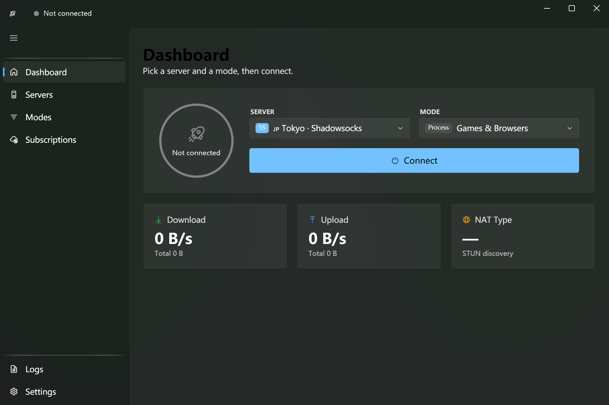

# Game+

A ground-up rewrite of [Netch](../netch) on **.NET 10**, the engine serving a modern
[Electron + Vue](../electron-app) frontend. Rebranded as **Game+**, a game accelerator.

It's a **working proxy client**, not just a shell: the bundled **xray** core routes real traffic
(ss / trojan / vmess / vless / socks) through a local SOCKS5 + HTTP proxy, and the **Windows system
proxy** is pointed at it — so every app that honours the system proxy goes through your server.
Turn it on in **Settings → "Use real proxy engine"**. A built-in **simulation** engine
(`ProxyEngine`) is the default so the UI is fully interactive with zero setup.

> Verified end-to-end: a real Shadowsocks chain (app → xray → SS protocol → server → internet)
> returns the proxied IP; `xray -test` validates every generated config.



## Architecture

This repository holds the **backend** (Netch.Core + Netch.Host) for Game+. The **only frontend** is the
Electron app in [`../electron-app`](../electron-app), which spawns `Netch.Host` as a headless sidecar and
drives it over a local WebSocket. There is no longer a bundled WPF UI.

```
NetchModern.slnx
├── src/Netch.Core          # UI-agnostic domain + services (net10.0-windows)
│   ├── Models/             # Server hierarchy, Mode, AppSettings, TrafficStats, LogEntry…
│   ├── Abstractions/       # IProxyService, IModeController(+Factory), IServerController, repositories
│   ├── Enums/              # AppState, NatType, LogLevel
│   ├── Interops/           # P/Invoke: RedirectorInterop (aio_*), Tun2socksInterop (LibraryImport)
│   ├── Controllers/        # RedirectorModeController, TunModeController, ModeControllerFactory
│   └── Services/           # ProxyEngine (sim) + NativeProxyEngine, V2ray config/controller,
│                           #   ProcessGuard, ShareLinkParser, repositories, persistence, seed data
│
└── src/Netch.Host          # Headless backend (net10.0-windows, exe → gameplus-host.exe)
    ├── Program.cs          # loopback HTTP/WebSocket server + GAMEPLUS_READY handshake
    ├── RpcRouter.cs        # JSON-RPC methods → Netch.Core operations
    └── ClientSession.cs    # one WebSocket session; pushes status/log events back
```

### Design choices vs. the original

| Original (WinForms, .NET 6)                       | This rewrite (.NET 10)                                  |
| ------------------------------------------------- | ------------------------------------------------------ |
| Static `Global` / `MainController` singletons     | DI container (`Microsoft.Extensions.DependencyInjection`) |
| Code-behind + designer files                      | Command-style headless design, MVVM where state drives UI |
| WinForms controls                                 | Vue + Electron frontend                                  |
| Tabbed dialogs                                    | Single-page app + navigation                             |
| `Server` POCO + manual events                     | Observable domain models (`[ObservableProperty]`)        |

## Requirements

- Windows 10 build 17763+ / Windows 11
- .NET 10 SDK (`10.0.301`+) with the Windows Desktop runtime

## Build & run

```powershell
# Backend (Netch.Core + Netch.Host)
dotnet build NetchModern.slnx

# Unit tests (Netch.Tests — AcceleratorService orchestration with fakes)
dotnet test NetchModern.slnx

# Stage the backend into electron-app/resources/backend so electron-builder can package it.
./build.ps1                        # self-contained win-x64
./build.ps1 -SelfContained:$false  # framework-dependent (needs the .NET 10 Desktop runtime)
```

>The host requests **administrator** rights via UAC when launched in production (the real Netch needs
>them for drivers, the route table and firewall rules), but does not itself declare an elevation
>requirement in dev — see [`electron-app/src/main/sidecar.ts`](../electron-app/src/main/sidecar.ts).
>
>Run the UI from [`electron-app`](../electron-app): `npm run dev`.

### Package the frontend

```powershell
# In electron-app/
npm run dist    # electron-vite build && electron-builder --win
```

`./build.ps1` stages the backend (plus native binaries) into `electron-app/resources/backend`, which
electron-builder packages as `resources/backend` in the distributable — matching the prod path in
`src/main/sidecar.ts`. It publishes **self-contained** (so the installer needs no .NET runtime),
reads the version from `electron-app/package.json`, and clears the staging dir to avoid stale binaries.
Drop the native binaries into `NetchModern/native/` to enable the native engine (a
`NATIVE_COMPONENTS.txt` is written to the staged `bin/` documenting the expected files).

The full end-to-end release flow (staging the backend, the installer, code signing and publishing) is
documented in [`electron-app/README.md`](../electron-app/README.md). The update checker compares the
installed version against the latest GitHub release of **`WyattCode/GamePlus`**.

## Status & roadmap

**Done — this milestone**

- [x] Solution, projects, packages (DI container, MVVM toolkit)
- [x] Core domain models + service abstractions
- [x] Headless backend (`Netch.Host`) — loopback WebSocket + JSON-RPC, spawned by the Electron sidecar
- [x] Simulated engine with live status + traffic; builds and runs
- [x] **Share-link import** — `ShareLinkParser` for `ss://`, `trojan://`, `vmess://`,
      `vless://` and Telegram socks links, plus Base64 subscription blobs
- [x] **JSON persistence** — polymorphic servers, modes and subscriptions saved to
      `%AppData%\NetchModern\` and reloaded on launch
- [x] **Server editor** — add/edit with a protocol picker and type-specific fields; changes persist
- [x] **Subscription fetch** — real `HttpClient` download → parse → merge into the server
      list grouped by subscription; re-updates replace cleanly (no duplicates)
- [x] **v2ray outbound** — `V2rayConfigGenerator` (Server → v2ray/xray JSON for ss/trojan/
      vmess/vless/socks/wireguard) + `ProcessGuard` + `V2rayServerController`
- [x] **Native interop + engine** — `RedirectorInterop`/`Tun2socksInterop`/`RouteHelperInterop`
      (P/Invoke via `LibraryImport`), `RedirectorModeController`/`TunModeController` (+ route-table
      setup) + factory, and `NativeProxyEngine` (MainController-style orchestration: DNS → server
      controller → mode controller → live traffic).
- [x] **STUN NAT detection** — `StunClient` (RFC 5389 binding + RFC 3489 change-request tests)
- [x] **Packaging** — `build.ps1` publishes the headless backend and stages it into
      `electron-app/resources/backend` for electron-builder.
- [x] **Update check** — `GitHubUpdateChecker` compares the latest GitHub release tag to the running
      version; surfaced in the Electron renderer.
- [x] **Share-link export** — `ShareLinkExporter` (round-trips with the parser)
- [x] **Atomic persistence** — settings and data save via write-temp-then-rename, so an interrupted
      write can't corrupt the file.
- [x] **Real proxy engine** 🎉 — bundled **xray** core (auto-copied to `bin/`), `V2rayServerController`
      launches it with a generated SOCKS5 + HTTP config, `SystemProxyService` sets/restores the WinINET
      system proxy, and `LocalProxyEngine` ties it together. Real traffic verified through a Shadowsocks
      chain.
- [x] **Live traffic counters** — the real engine enables xray's stats API and polls
      `xray api statsquery`, so the dashboard shows actual up/down bytes (verified: 1 MB download →
      `down=1012284`).
- [x] Servers/subscriptions start **empty** (no fake demo data); mode templates are still seeded.

**Next**

- [ ] Transparent capture modes (Process via netfilter2, TUN via tun2socks/wintun) — code + interop
      are in place; need the driver binaries + admin install
- [ ] Share mode (pcap), Serilog file logging

### Engine architecture

The backend wires a single engine in `Netch.Host/Composition.cs`:

- **`AcceleratorService`** (the one and only implementation of `IAcceleratorService`) — resolves the
  chosen node, starts the matching core (`V2rayServerController` / `SingBoxServerController`) for its
  protocol, brings up traffic capture via `IModeControllerFactory` (process/netfilter or IP/TUN), points
  the Windows system proxy at the local endpoint for domain routing, and continuously measures
  latency / jitter / loss plus polls traffic stats. It is driven over JSON-RPC by the frontend.

There is no simulated/real engine selection anymore — `useRealEngine` was a dead setting, and the
previous `IProxyService` implementations (`ProxyEngine`, `NativeProxyEngine`, `LocalProxyEngine`) were
unwired and have been removed. The simulation that `MockBackend` provides now lives entirely in the
Electron renderer (`electron-app/src/renderer/src/api/backend.ts`), which is only used when running the
UI outside Electron (browser preview).
