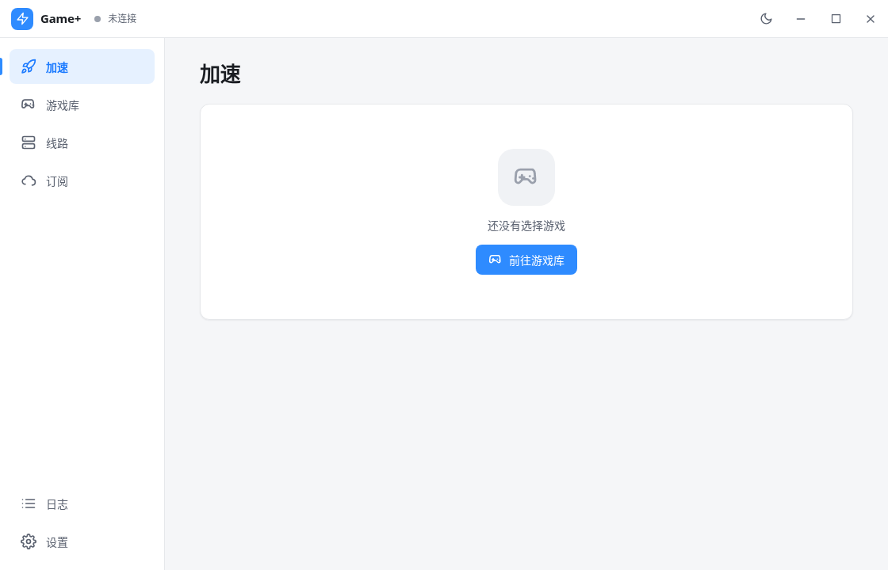

# Game+

The **backend** of Game+, a Windows game accelerator: a ground-up rewrite of
[Netch](https://github.com/NetchX/Netch) on **.NET 10**, serving the
[Electron + Vue frontend](../electron-app). It is a working proxy client — the bundled
**Xray** / **sing-box** cores route real traffic through a local SOCKS5 + HTTP endpoint, and the
Windows system proxy is pointed at it, so every app that honours the system proxy goes through your
server.



## Architecture

This repository holds the **backend** (Netch.Core + Netch.Host) for Game+. The **only frontend** is the
Electron app in [`../electron-app`](../electron-app), which spawns `Netch.Host` as a headless sidecar and
drives it over a local WebSocket. There is no longer a bundled WPF UI.

```
NetchModern.slnx
├── src/Netch.Core          # UI-agnostic domain + services (net10.0-windows)
│   ├── Models/             # Server hierarchy, Mode, AppSettings, TrafficStats, LogEntry…
│   ├── Abstractions/       # IAcceleratorService, IModeController(+Factory), IServerController, repositories
│   ├── Enums/              # AppState, LogLevel
│   ├── Interops/           # P/Invoke: RedirectorInterop (aio_*), Tun2socksInterop (LibraryImport)
│   ├── Controllers/        # RedirectorModeController, TunModeController, ModeControllerFactory
│   └── Services/           # AcceleratorService, V2ray/SingBox config + controllers, ProcessGuard,
│                           #   ShareLinkParser/Exporter, SystemProxyService, repositories, persistence
│
└── src/Netch.Host          # Headless backend (net10.0-windows, exe → gameplus-host.exe)
    ├── Program.cs          # loopback HTTP/WebSocket server + GAMEPLUS_READY handshake
    ├── RpcRouter.cs        # JSON-RPC methods → Netch.Core operations
    └── ClientSession.cs    # one WebSocket session; pushes status/log events back
```

### Design choices vs. the original

| Original (WinForms, .NET 6)                       | This rewrite (.NET 10)                                  |
| ------------------------------------------------- | ------------------------------------------------------ |
| Static `Global` / `MainController` singletons     | DI container (`Microsoft.Extensions.DependencyInjection`) |
| Code-behind + designer files                      | Command-style headless design, MVVM where state drives UI |
| WinForms controls                                 | Vue + Electron frontend                                  |
| Tabbed dialogs                                    | Single-page app + navigation                             |
| `Server` POCO + manual events                     | Observable domain models (`[ObservableProperty]`)        |

### Engine architecture

The backend wires a single engine in `Netch.Host/Composition.cs`:

- **`AcceleratorService`** (the one and only implementation of `IAcceleratorService`) — resolves the
  chosen node, starts the matching core (`V2rayServerController` / `SingBoxServerController`) for its
  protocol, brings up traffic capture via `IModeControllerFactory`, points the Windows system proxy at
  the local endpoint for domain routing, and continuously measures latency / jitter / loss plus polls
  traffic stats. It is driven over JSON-RPC by the frontend.
- **Degradation chain** — process mode (netfilter2) → TUN mode (tun2socks + WinTUN) → system proxy.
  If a capture mode cannot start (missing driver, no admin), the accelerator falls back to the next
  one instead of failing outright.
- **Cores** — `V2rayServerController` (Xray) and `SingBoxServerController` (sing-box) generate the
  core config, launch the process under `ProcessGuard`, and expose the local SOCKS5 + HTTP endpoint.
- **Protocols** — ss / trojan / vmess / vless / socks, including the `ws`, `grpc`, `h2`,
  `httpupgrade` and `xhttp` transports, TLS and Reality, WireGuard, and Shadowsocks plugins
  (via sing-box).
- **Control plane** — `Netch.Host` listens on a loopback HTTP/WebSocket endpoint and prints a
  `GAMEPLUS_READY {port,pid}` handshake on stdout (and into the connection file) so the Electron
  sidecar can discover the port. The shared secret is **not** in that handshake: Electron generates
  it, passes only its SHA-256 to the host via `--token-sha256`, and the host compares the client's
  token hash in constant time on every connection. `RpcRouter` maps JSON-RPC methods onto
  Netch.Core operations; `ClientSession` pushes status/log events back to the renderer.
- **Crash recovery** — on startup the host restores a system proxy left behind by a previous run and
  kills orphaned core processes.
- **Update check** — `GitHubUpdateChecker` compares the latest GitHub release tag to the running
  version; the source is configurable (see [`electron-app/README.md`](../electron-app/README.md)).

There is no simulated/real engine selection anymore — `useRealEngine` was a dead setting, and the
previous `IProxyService` implementations (`ProxyEngine`, `NativeProxyEngine`, `LocalProxyEngine`) were
unwired and have been removed. The simulation that `MockBackend` provides now lives entirely in the
Electron renderer (`electron-app/src/renderer/src/api/backend.ts`), which is only used when running the
UI outside Electron (browser preview).

## Requirements

- Windows 10 build 17763+ / Windows 11
- .NET 10 SDK (`10.0.301`+) with the Windows Desktop runtime

## Build & run

```powershell
# Backend (Netch.Core + Netch.Host)
dotnet build NetchModern.slnx

# Unit tests (Netch.Tests — AcceleratorService orchestration with fakes)
dotnet test NetchModern.slnx

# Stage the backend into electron-app/resources/backend so electron-builder can package it.
./build.ps1                        # self-contained win-x64
./build.ps1 -SelfContained:$false  # framework-dependent (needs the .NET 10 Desktop runtime)
```

>The host requests **administrator** rights via UAC when launched in production (the real Netch needs
>them for drivers, the route table and firewall rules), but does not itself declare an elevation
>requirement in dev — see [`electron-app/src/main/sidecar.ts`](../electron-app/src/main/sidecar.ts).
>
>Run the UI from [`electron-app`](../electron-app): `npm run dev`.

The test project targets `net10.0-windows` (it references the Windows-targeted `Netch.Core`), but it
builds and runs on Linux as well: the Windows-only interop is behind abstractions/fakes, and the
Windows targeting packs are pulled in with `-p:EnableWindowsTargeting=true`:

```bash
dotnet test NetchModern.slnx -p:EnableWindowsTargeting=true
```

### Native binaries

`build.ps1` stages the native cores from `NetchModern/native/` into the published `bin/` and then
**verifies** that every required component is present — a missing required component fails the build
(use `-AllowMissingNative` to downgrade that to a warning for dev/CI packaging tests). The expected
components, their purpose, licences and download URLs are documented in
[`native/README.md`](native/README.md); the staged `bin/NATIVE_COMPONENTS.txt` records, per file,
whether it is present plus its size and SHA-256.

### Package the frontend

```powershell
# In electron-app/
npm run dist    # electron-vite build && electron-builder --win
```

`./build.ps1` stages the backend (plus native binaries) into `electron-app/resources/backend`, which
electron-builder packages as `resources/backend` in the distributable — matching the prod path in
`src/main/sidecar.ts`. It publishes **self-contained** (so the installer needs no .NET runtime),
reads the version from `electron-app/package.json`, and clears the staging dir to avoid stale binaries.

The full end-to-end release flow (staging the backend, the installer, code signing and publishing) is
documented in [`electron-app/README.md`](../electron-app/README.md). The update checker compares the
installed version against the latest GitHub release of **`WyattCode/GamePlus`**.

## Status & roadmap

**Done**

- [x] Solution, projects, packages (DI container, MVVM toolkit)
- [x] Core domain models + service abstractions
- [x] Headless backend (`Netch.Host`) — loopback WebSocket + JSON-RPC with SHA-256 token handshake,
      spawned by the Electron sidecar
- [x] **Share-link import/export** — `ShareLinkParser` / `ShareLinkExporter` for `ss://`,
      `trojan://`, `vmess://`, `vless://`, `wireguard://` / `wg://` and Telegram socks links, plus
      Base64 subscription blobs
- [x] **JSON persistence** — polymorphic servers and subscriptions (plus `settings.json` and custom
      games) saved to `%AppData%\Game+\` (the legacy `%AppData%\NetchModern\` folder is migrated on
      first launch) and reloaded on launch; writes are atomic (write-temp-then-rename)
- [x] **Server editor** — add/edit with a protocol picker and type-specific fields; changes persist
- [x] **Subscription fetch** — real `HttpClient` download → parse → merge into the server
      list grouped by subscription; re-updates replace cleanly (no duplicates)
- [x] **v2ray outbound** — `V2rayConfigGenerator` (Server → v2ray/xray JSON for ss/trojan/
      vmess/vless/socks/wireguard) + `ProcessGuard` + `V2rayServerController`
- [x] **sing-box outbound** — `SingBoxConfigGenerator` + `SingBoxServerController` (hysteria2,
      Shadowsocks plugins)
- [x] **Native interop + capture modes** — `RedirectorInterop`/`Tun2socksInterop`/`RouteHelperInterop`
      (P/Invoke via `LibraryImport`), `RedirectorModeController`/`TunModeController` (+ route-table
      setup) + factory, and the process → TUN → system-proxy degradation chain in `AcceleratorService`
- [x] **Real proxy engine** — bundled **Xray** core (staged into `bin/`), `V2rayServerController`
      launches it with a generated SOCKS5 + HTTP config, `SystemProxyService` sets/restores the WinINET
      system proxy, and `AcceleratorService` ties it together. Routes real traffic through a
      Shadowsocks chain.
- [x] **Live traffic counters** — the real engine enables xray's stats API and polls
      `xray api statsquery`, so the dashboard shows actual up/down bytes (e.g. a 1 MB download
      reports `down=1012284`).
- [x] **Crash recovery** — restores a system proxy left behind by a previous run and kills orphaned
      core processes on startup.
- [x] **Packaging** — `build.ps1` publishes the headless backend, stages it into
      `electron-app/resources/backend` for electron-builder, and verifies the native components.
- [x] **Update check** — `GitHubUpdateChecker` compares the latest GitHub release tag to the running
      version; surfaced in the Electron renderer.
- [x] Servers/subscriptions start **empty** (no fake demo data).

**Next**

- [ ] Serilog file logging

## Known limitations / not verified

- **Windows-only runtime.** The backend targets `net10.0-windows`; only the unit tests run on Linux.
- **Capture modes need admin + drivers.** Process mode (netfilter2) and TUN mode (tun2socks/WinTUN)
  require administrator rights and the corresponding driver binaries; without them Game+ falls back to
  the system proxy.
- **Native binaries are not in the repository.** `NetchModern/native/` is git-ignored; you must
  populate it before packaging — see [`native/README.md`](native/README.md).

## License

Game+ is licensed under the **GNU General Public License v3.0** (`GPL-3.0-only`). See
[`LICENSE`](../LICENSE) and [`THIRD_PARTY_NOTICES.md`](../THIRD_PARTY_NOTICES.md) for the full
licence text and third-party attributions.
