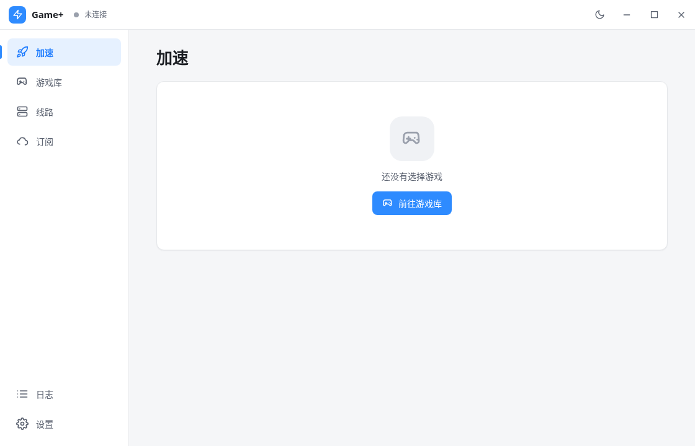

# Game+

Game+ is a **Windows game accelerator**: it routes a game's (or any app's) traffic through a proxy
server you configure, using the bundled **Xray** / **sing-box** cores, with process-level, TUN or
system-proxy capture.



## Repository layout

```
.
├── electron-app/     # Electron + Vue 3 + TypeScript frontend (the only UI)
├── NetchModern/      # .NET 10 backend (Netch.Core + Netch.Host → gameplus-host.exe)
│   ├── src/          #   Netch.Core (domain/services) + Netch.Host (headless JSON-RPC server)
│   ├── native/       #   native binaries (git-ignored; see native/README.md)
│   └── build.ps1     #   publishes + stages the backend for electron-builder
├── LICENSE           # GPL-3.0-only
└── THIRD_PARTY_NOTICES.md
```

The Electron main process spawns `gameplus-host.exe` as a sidecar and talks to it over a loopback
WebSocket (JSON-RPC, SHA-256 token handshake). See [`NetchModern/README.md`](NetchModern/README.md)
for the backend architecture and [`electron-app/README.md`](electron-app/README.md) for the frontend.

## Quick start (development)

Requirements: Windows 10 build 17763+ / Windows 11, [Node.js](https://nodejs.org) **22.12 or newer**
(with npm) and the [.NET 10 SDK](https://dotnet.microsoft.com).

```powershell
# 1) Backend
cd NetchModern
dotnet build NetchModern.slnx
dotnet test  NetchModern.slnx      # unit tests (also run on Linux)

# 2) Frontend
cd ../electron-app
npm ci
npm run dev                        # electron-vite dev (Vite HMR + Electron)
```

`npm run dev` spawns the debug backend from
`NetchModern/src/Netch.Host/bin/Debug/net10.0-windows/gameplus-host.exe`; build it first if it is
missing.

## Release build

The distributable is an NSIS installer produced in two stages — stage 1 stages the backend, stage 2
packages it:

```powershell
cd NetchModern
.\build.ps1                        # → electron-app/resources/backend

cd ../electron-app
npm run dist                       # → dist/Game+-<version>-<arch>.exe
```

The full release flow (code signing, publishing, update checks) is documented in
[`electron-app/README.md`](electron-app/README.md).

## Native binaries

The proxy cores and capture helpers are **not** committed to this repository. Populate
`NetchModern/native/` before packaging — `build.ps1` verifies the required components and fails the
build if any are missing (`-AllowMissingNative` downgrades that to a warning for dev/CI packaging
tests). See [`NetchModern/native/README.md`](NetchModern/native/README.md) for the component list,
licences and download URLs.

## 更新与规则源 / Update & rules sources

自动更新和游戏规则库默认都是**空的**，对应功能处于关闭状态；两者都在 **设置 → 软件更新** 和
**设置 → 游戏规则库** 中配置，URL 完全由用户决定。

- **自动更新 / Auto update**：支持两种来源 —— 更新清单 JSON，或 GitHub Releases。清单格式为
  `{ "version", "url", "sha256", "notes" }`，其中 `sha256` 为必填（用于校验下载的安装包）。
- **游戏规则库 / Game rules**：规则库 URL 指向一份规则文件，格式见
  [`NetchModern/docs/game-rules.md`](NetchModern/docs/game-rules.md)。

本项目计划后续把更新清单和规则库托管在公开的 release 仓库或对象存储（OSS）上；在此之前请自行
填写可访问的地址。

Auto update and the game rules library are **empty by default** (the features are disabled). Both are
configured in **Settings → Software update** and **Settings → Game rules**; the URLs are entirely
user-supplied. Auto update accepts either a manifest JSON or GitHub Releases; the manifest format is
`{ "version", "url", "sha256", "notes" }` with `sha256` required. The rules file format is documented
in [`NetchModern/docs/game-rules.md`](NetchModern/docs/game-rules.md). The project plans to host the
manifest and rules on a public release repo or OSS later.

## 安装包未签名 / Unsigned installer

安装包**没有代码签名**。首次运行时 Windows SmartScreen 会提示「Windows 已保护你的电脑」：

1. 点击「更多信息」；
2. 点击「仍要运行」。

可选：下载后校验安装包的 SHA-256，与发布页给出的值比对：

```powershell
certutil -hashfile "Game+-x.y.z-x64.exe" SHA256
# 或
Get-FileHash "Game+-x.y.z-x64.exe" -Algorithm SHA256
```

加速功能会安装 netfilter / WinTUN 驱动，部分杀毒软件可能误报，请自行判断是否信任。

The installer is **not code-signed**. On first run Windows SmartScreen shows
"Windows 已保护你的电脑" — click 「更多信息」 → 「仍要运行」. Optionally verify the SHA-256 of the
downloaded installer (`certutil -hashfile "Game+-x.y.z-x64.exe" SHA256` or PowerShell
`Get-FileHash`) against the published value. Antivirus software may flag the netfilter / WinTUN
drivers bundled for acceleration.

## 隐私 / Privacy

Game+ 是**个人使用**版本：没有账号系统，也不会上传任何数据。

- 可选的**本地诊断记录**：只在本机记录加速成功/失败、使用的加速模式和失败原因（已去除 IP、域名、
  路径和用户名），可在设置中随时查看和清除。
- **崩溃报告**只保存在本机，不会上传；可在提交问题时手动附上。

本地文件位置：

- `%AppData%\Game+\crashes` —— 后端（host）崩溃报告；
- Electron userData 目录下的 `crashes` 和 `telemetry` 文件夹 —— 前端崩溃报告与本地诊断日志。

Game+ is a **personal-use** build: there are no accounts and nothing is ever uploaded.

- Optional **local diagnostics log**: records acceleration success/failure, the acceleration mode
  used and the failure reason (with IP, domain, path and user name removed) on this machine only.
  It can be viewed and cleared at any time in Settings.
- **Crash reports** are stored locally only and never uploaded; you can attach them manually when
  filing an issue.

Local file locations:

- `%AppData%\Game+\crashes` — backend (host) crash reports;
- the `crashes` and `telemetry` folders under the Electron userData directory — renderer crash
  reports and the local diagnostics log.

## License

Game+ is licensed under the **GNU General Public License v3.0** (`GPL-3.0-only`). See
[`LICENSE`](LICENSE) and [`THIRD_PARTY_NOTICES.md`](THIRD_PARTY_NOTICES.md) for the full licence text
and third-party attributions.
